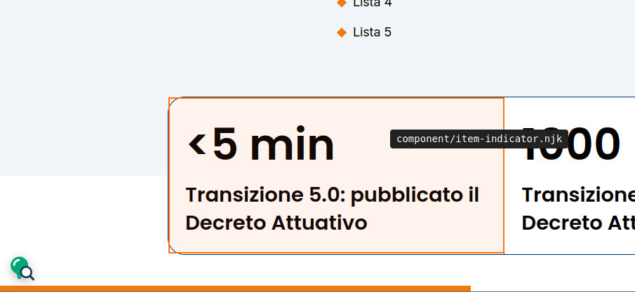
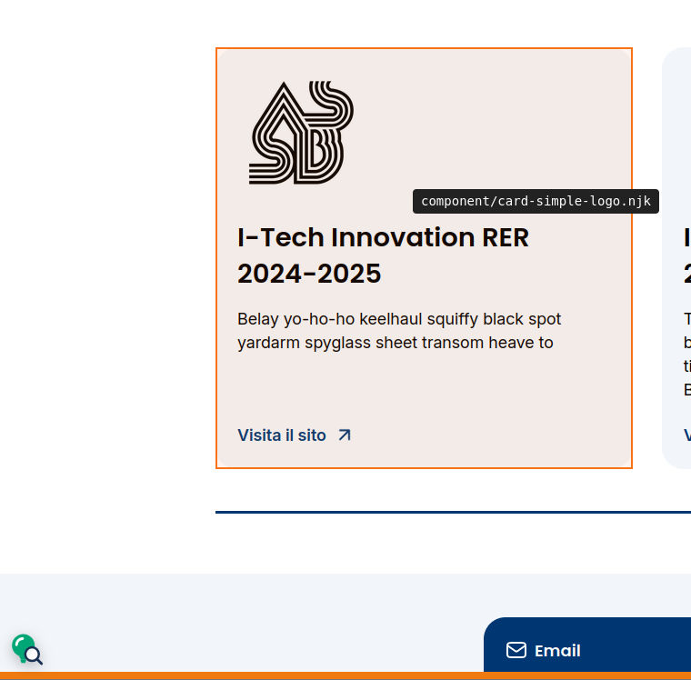

<p align="center">
	
</p>

# eleventy-debug-inspector

> A development visual inspector for Eleventy projects using Nunjucks. It marks static includes and imported macro calls with HTML comments, then highlights the corresponding rendered content and template path in the browser. This plugin works only with Nunjucks templates.


[](https://lbesson.mit-license.org/)

## Installation

[npm package](https://www.npmjs.com/package/@saiballo/eleventy-debug-inspector)

```sh
npm install @saiballo/eleventy-debug-inspector --save-dev
```

Add the plugin to your `eleventy.config.js` file:

```js
const debugInspector = require("@saiballo/eleventy-debug-inspector");

module.exports = function(eleventyConfig) {

	eleventyConfig.addPlugin(debugInspector);
};
```

#### Options Parameters

You can override the default options when registering the plugin:

```js
const debugInspector = require("@saiballo/eleventy-debug-inspector");

module.exports = function(eleventyConfig) {

	eleventyConfig.addPlugin(debugInspector, {
		"runOnlyDevMode": true,
		"shortcodeName": "debugInspector",
		"overlayBorderColor": "#f97316",
		"overlayBackgroundColor": "rgba(249, 115, 22, 0.08)",
		"labelBackgroundColor": "#222",
		"labelTextColor": "white",
		"labelFontSize": "14px"
	});
};
```

#### Parameters

- `runOnlyDevMode`: when `true`, the inspector is disabled if `NODE_ENV` is set to `production`. Set it to `false` to enable the plugin in production builds too.
- `shortcodeName`: name of the Nunjucks shortcode used to insert the inspector script. If you change it, use the same name in the template.
- `overlayBorderColor`: color of the highlighted component border. The border remains `2px solid`.
- `overlayBackgroundColor`: background color of the highlighted component.
- `labelBackgroundColor`: background color of the template path label.
- `labelTextColor`: text color of the template path label.
- `labelFontSize`: font size of the template path label.

CSS options must be non-empty strings. They accept normal CSS values such as hexadecimal colors, `rgb()`, `rgba()`, CSS custom properties and units such as `px` or `rem`. Invalid or empty option types fall back to their default values.

## Usage

Add the shortcode once to the main Nunjucks layout, preferably immediately before the closing `</body>` tag:

```njk
	
</body>
```

The shortcode is the placeholder that Eleventy replaces with the inline inspector script. It can also be placed in another Nunjucks template, as long as that template is rendered after the page content to inspect.

If you changed `shortcodeName`, use the configured name instead:

```njk

```

While Eleventy renders Nunjucks templates with the inspector enabled (by default, only during development), the plugin adds markers around supported components without introducing wrapper elements or `data-*` attributes:

```html
<!-- DEBUG INSPECTOR:START view/_include/component/example.njk -->
<!-- rendered component content -->
<!-- DEBUG INSPECTOR:END view/_include/component/example.njk -->
```

#### Screenshots





## Activation

Press <kbd>Alt</kbd> + <kbd>X</kbd> in the browser to enable or disable the inspector.

When the inspector is active:

- its status icon appears in the bottom-left corner;
- moving the pointer over supported rendered content displays an overlay around the component;
- a label shows the source Nunjucks template path.

By default, production builds do not add debug comments and the shortcode returns an empty string.

## Limitations

- The plugin works only with Nunjucks templates.
- Includes must use a literal path, for example ``. Dynamic paths such as `` cannot be inspected.
- Macro calls are inspected only when the macro is imported with ``. Multiple imports and aliases are supported.
- Namespace imports such as `` followed by `component.macroName()` are not inspected.
- Macros declared locally in the current template are not inspected.
- `` declarations are not marked as inspectable regions. Supported includes and imported macro calls inside loaded layouts are still processed.
- Elements added to the DOM by client-side JavaScript after the inspector script has run are not mapped automatically.
- A component that renders only text, or has no element with a measurable area, may not provide a target that can be highlighted.

Static nested includes and imported macro calls are supported because every loaded Nunjucks template is preprocessed.

## Team ARMADA 429


* Lorenzo "Saibal" Forti

## License


